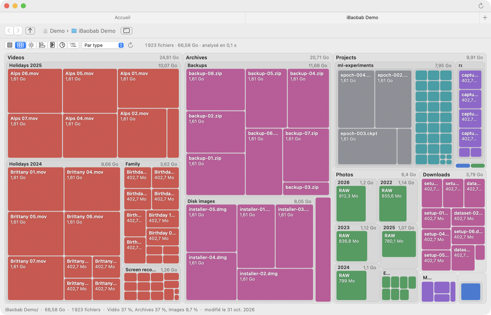
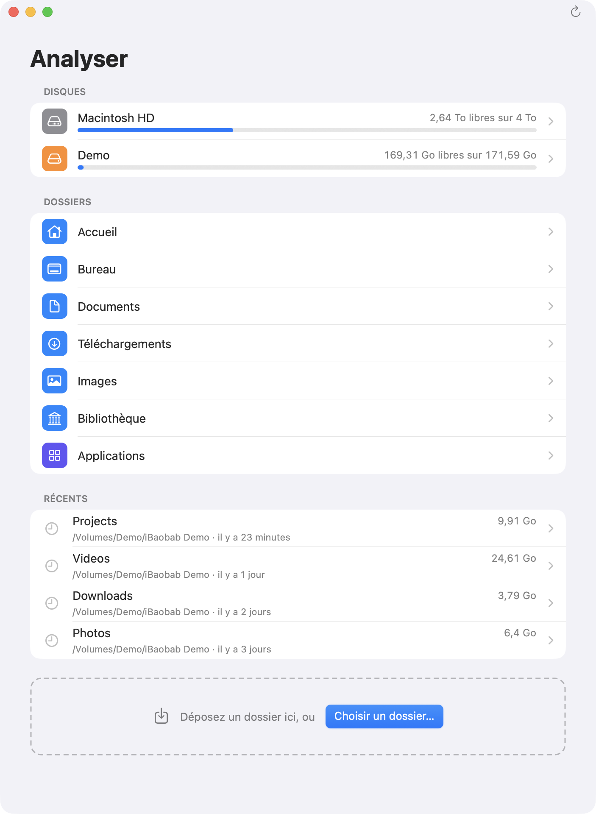
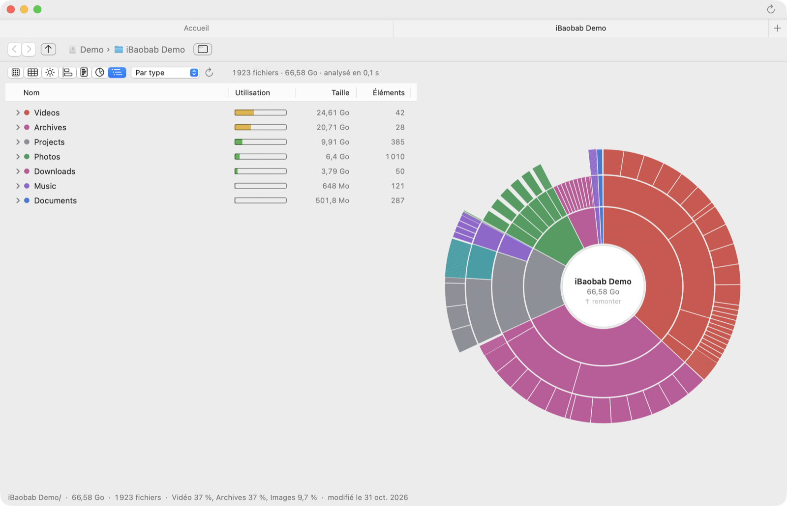
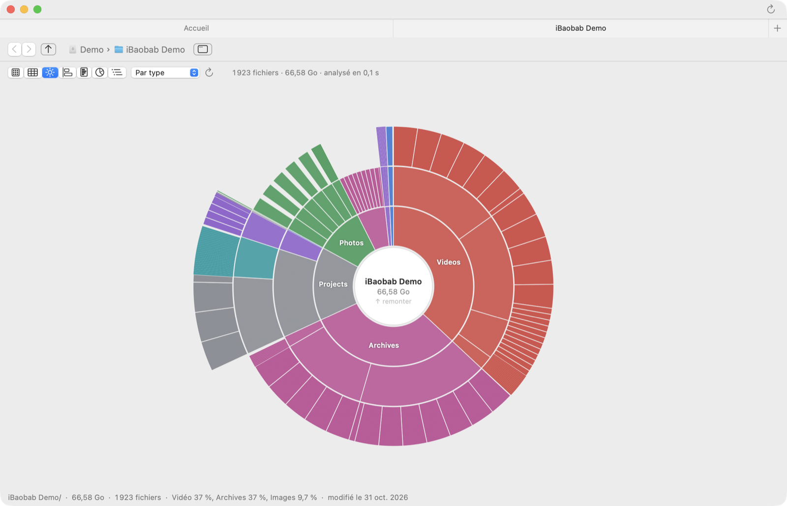
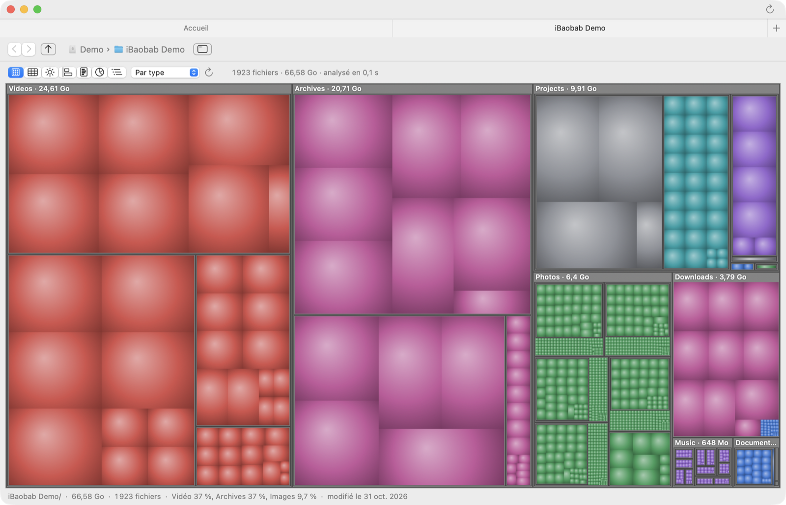
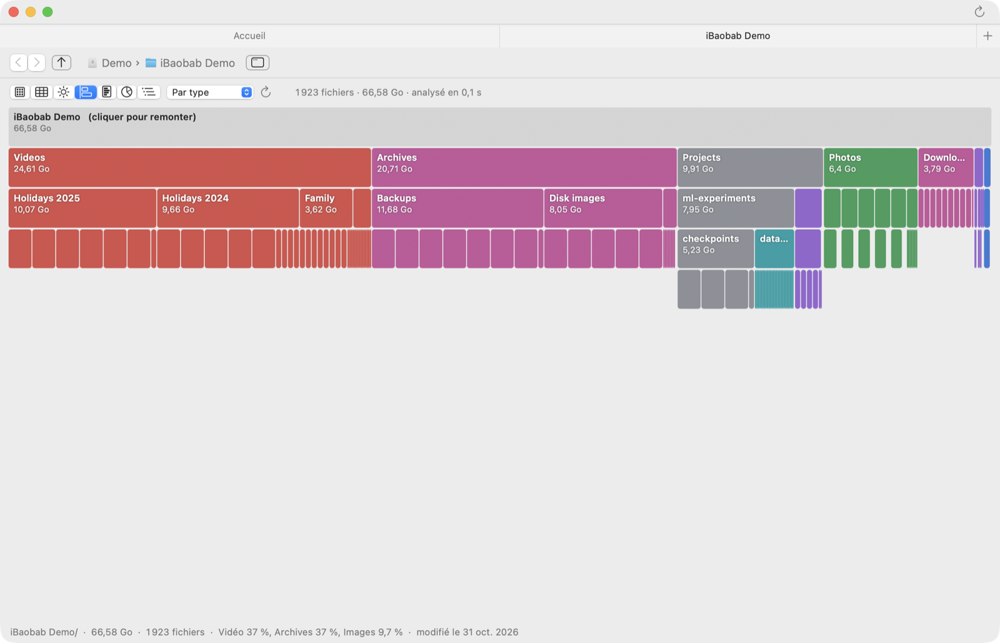
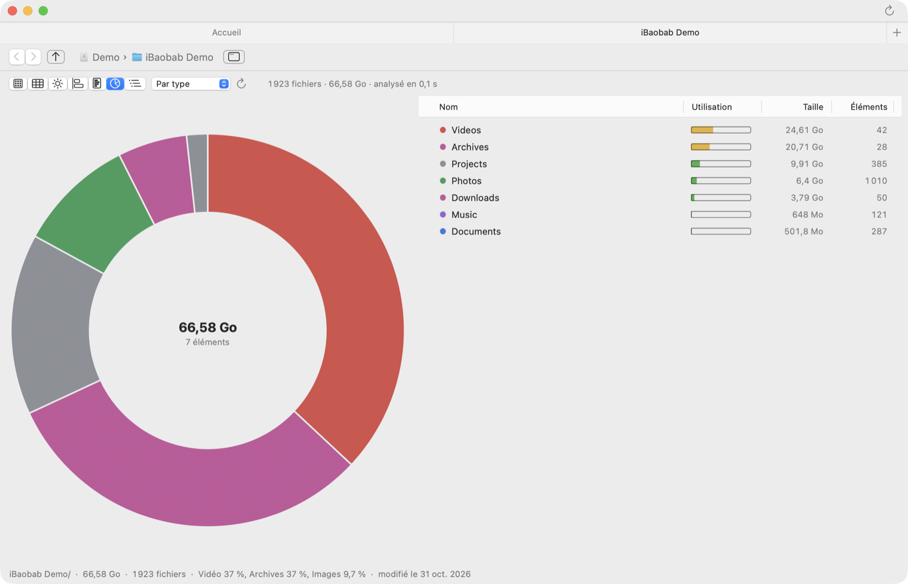
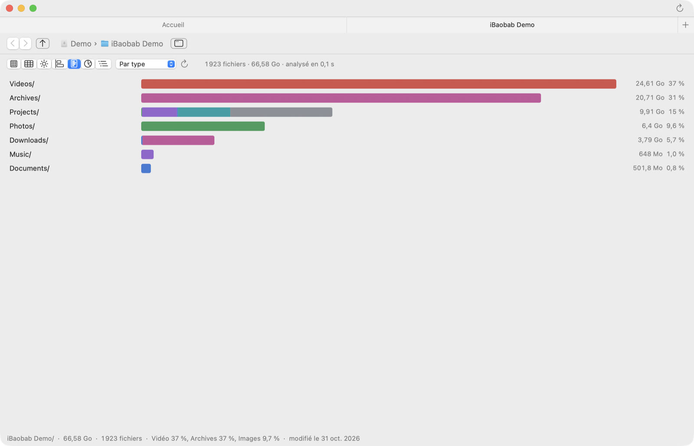
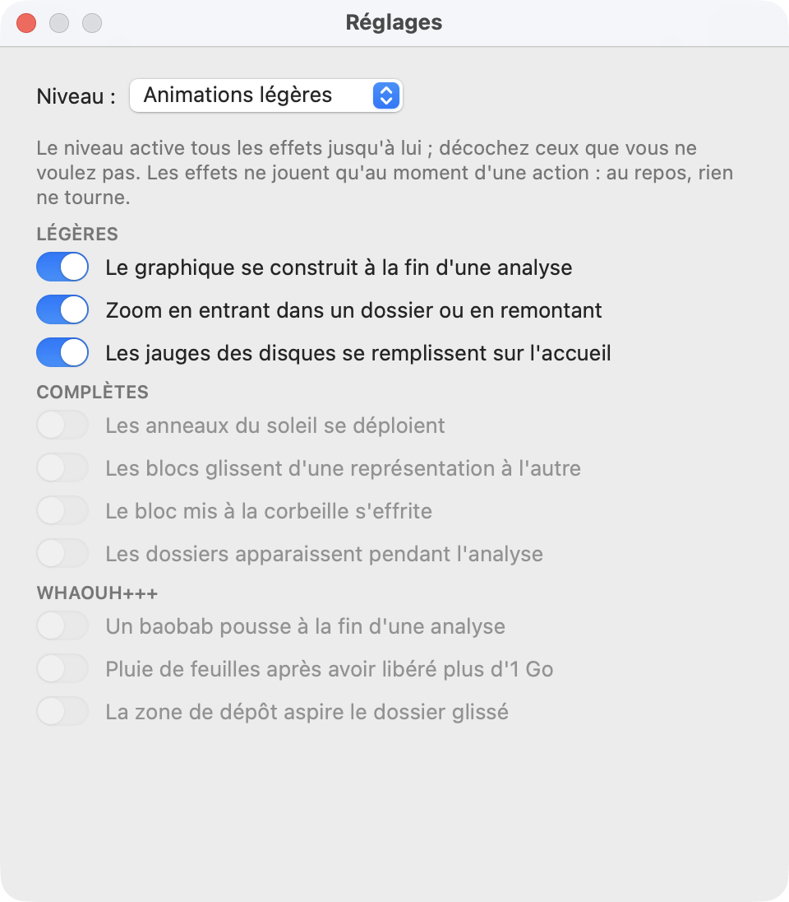

<p align="right"><a href="README.md">English</a> · <b>Français</b></p>

# iBaobab

**Voir d'un coup d'œil ce qui remplit votre disque, et faire de la place.**

iBaobab est un analyseur d'occupation des disques pour macOS, dans l'esprit de l'Analyseur d'utilisation des disques de GNOME (Baobab). Il analyse un disque ou un dossier, puis vous laisse parcourir le résultat à travers sept graphiques, colorés par type de fichier, par ancienneté ou par branche. Swift et AppKit natifs, sans dépendance externe.

<p align="center">
  <picture>
    <source media="(prefers-color-scheme: dark)" srcset="docs/images/fr/flat-dark.png">
    
  </picture>
</p>

> Les captures montrent un dossier de démonstration fictif.

## Fonctionnalités

- **Accueil** en listes groupées : vos disques (barre d'occupation, espace libre), les dossiers usuels, les analyses récentes (taille et date) et une zone où déposer un dossier. On peut aussi déposer un dossier sur l'icône du Dock.
- **Analyse rapide et légère** : chaque dossier est lu en quelques appels système, les sous-dossiers en parallèle ; l'analyse de `/Applications` (environ 570 000 fichiers) tient dans 50 Mo de mémoire environ.
- **Sept vues**, à un clic ou par ⌘1 … ⌘7 : carte coussin, carte épurée, soleil, partition empilée, histogramme, anneau et liste, liste et soleil.
- **Trois colorations** : par type de fichier (vidéo, images, audio, code, archives, documents), par ancienneté ou par branche.
- **Navigation** en cliquant dans un dossier, avec le fil d'Ariane, précédent / suivant (⌘[ / ⌘]) et le dossier parent (⌘↑ ou ⌫). Le survol affiche la taille, la part du parent, le nombre de fichiers, les types principaux et la date.
- **Onglets natifs** : chaque analyse s'ouvre dans un onglet ; ⌘clic ouvre un sous-dossier dans un nouvel onglet sans nouvelle analyse.
- **Actions** : Afficher dans le Finder (⌥⌘R), Placer dans la corbeille, Analyser de nouveau (⌘R).
- **Animations à votre goût** : quatre niveaux (sans animation, légères par défaut, complètes, Whaouh+++) et un interrupteur par effet. Les effets ne jouent qu'au moment d'une action : au repos, rien ne tourne, et aucun ne joue si « Réduire les animations » est activé.
- **Français et anglais**, selon la langue du système.
- **Mises à jour automatiques**, vérifiées par une signature Ed25519.

## Captures d'écran

### Accueil

Les disques, les dossiers usuels, les analyses récentes et une zone où déposer n'importe quel dossier.

<p align="center">
  <picture>
    <source media="(prefers-color-scheme: dark)" srcset="docs/images/fr/home-dark.png">
    
  </picture>
</p>

### Sept façons de regarder un dossier

<table>
  <tr>
    <td width="50%">
      <picture>
        <source media="(prefers-color-scheme: dark)" srcset="docs/images/fr/list-sunburst-dark.png">
        
      </picture>
      <p align="center"><b>Liste et soleil</b></p>
    </td>
    <td width="50%">
      <picture>
        <source media="(prefers-color-scheme: dark)" srcset="docs/images/fr/sunburst-dark.png">
        
      </picture>
      <p align="center"><b>Soleil</b></p>
    </td>
  </tr>
  <tr>
    <td>
      <picture>
        <source media="(prefers-color-scheme: dark)" srcset="docs/images/fr/cushion-dark.png">
        
      </picture>
      <p align="center"><b>Carte coussin</b></p>
    </td>
    <td>
      <picture>
        <source media="(prefers-color-scheme: dark)" srcset="docs/images/fr/icicle-dark.png">
        
      </picture>
      <p align="center"><b>Partition empilée</b></p>
    </td>
  </tr>
  <tr>
    <td>
      <picture>
        <source media="(prefers-color-scheme: dark)" srcset="docs/images/fr/donut-dark.png">
        
      </picture>
      <p align="center"><b>Anneau et liste</b></p>
    </td>
    <td>
      <picture>
        <source media="(prefers-color-scheme: dark)" srcset="docs/images/fr/histogram-dark.png">
        
      </picture>
      <p align="center"><b>Histogramme</b></p>
    </td>
  </tr>
</table>

### Animations

Choisissez un niveau, puis désactivez les effets dont vous ne voulez pas : le graphique qui se construit, le zoom dans les dossiers, les anneaux du soleil qui se déploient, les blocs qui glissent d'une vue à l'autre, un baobab qui pousse à la fin d'une analyse…

<p align="center">
  <picture>
    <source media="(prefers-color-scheme: dark)" srcset="docs/images/fr/settings-dark.png">
    
  </picture>
</p>

## Installation

Avec [Homebrew](https://brew.sh) :

```bash
brew install --cask blegal/tap/ibaobab
```

Ou à la main :

1. Téléchargez `iBaobab-<version>.dmg` depuis la [dernière release](https://github.com/blegal/iBaobab/releases/latest).
2. Ouvrez-le et glissez **iBaobab** dans **Applications**.
3. L'application n'est pas notarisée par Apple. Au premier lancement, ouvrez **Réglages Système › Confidentialité et sécurité** et cliquez sur **Ouvrir quand même**, ou lancez :

   ```bash
   xattr -dr com.apple.quarantine /Applications/iBaobab.app
   ```

iBaobab se met ensuite à jour tout seul : l'indicateur à droite de la barre de titre passe au vert quand une version est disponible (jaune pendant le téléchargement), et **iBaobab › Rechercher les mises à jour…** vérifie à la demande. Chaque mise à jour est vérifiée par une signature Ed25519 avant d'être installée.

Nécessite macOS 15 ou plus récent, sur Apple Silicon ou Intel.

## Fonctionnement

- **Analyse** : `getattrlistbulk` lit un dossier entier en quelques appels système (nom, type, taille allouée, date) ; les sous-dossiers sont analysés en parallèle. Les tailles sont les tailles allouées, comme dans « Lire les informations » du Finder.
- **Mémoire** : chaque fichier ou dossier tient dans un nœud compact (compteurs et dates regroupés, noms partagés).
- **Dessin** : les graphiques sont dessinés avec Core Graphics, seulement quand c'est nécessaire. Les animations partent d'images du graphique capturées avant et après un changement, et l'horloge d'affichage ne tourne que pendant un effet.
- **Mises à jour** : l'application interroge l'API GitHub sur la dernière release, télécharge le DMG, vérifie sa signature avec CryptoKit et la clé publique embarquée dans `Info.plist`, puis remplace le paquet et relance l'application.

## Compiler depuis les sources

```bash
./build.sh          # produit build/iBaobab.app (signée ad hoc)
open build/iBaobab.app
```

Chaque build reçoit une nouvelle signature ad hoc, et macOS redemande ses autorisations (Documents, Bureau, disques…).
Lancez une fois `Tools/make-local-cert.sh` : il crée un certificat de signature personnel, « Local Code Signing », commun à mes autres apps, dans votre trousseau, et
`build.sh` signe ensuite chaque build avec lui, si bien que les autorisations sont gardées d'un build à l'autre.

Nécessite Xcode (Swift 6). `UNIVERSAL=1 VERSION=1.0.0 ./build.sh` produit un binaire Apple Silicon + Intel, et `Tools/make-dmg.sh` l'image disque.

Le workflow `.github/workflows/release.yml` construit le DMG à chaque push sur `main` (artefact du run, 30 jours) et publie une release GitHub, avec sa signature, pour chaque tag `v*` :

```bash
git tag v1.0.0 && git push origin v1.0.0
```

- `Tools/bump-version.sh` : incrémente la version avant un commit (`minor` ou `major` en option).
- `Tools/l10n.py build` : régénère `Resources/en.lproj/Localizable.strings` à partir de `Tools/l10n/en.json` (le code est écrit en français).
- `swift Tools/make-update-key.swift` : produit la paire de clés de mise à jour. La clé privée va dans le secret `UPDATE_SIGNING_KEY` du dépôt, la clé publique dans `Resources/Info.plist`. Les secrets facultatifs `MACOS_CERTIFICATE_P12` et `MACOS_CERTIFICATE_PASSWORD` signent avec un certificat stable.

## Bibliothèques partagées

Le paquet exporte deux bibliothèques, utilisées aussi par [iExplorer](https://github.com/blegal/iExplorer) et [GitWatch](https://github.com/blegal/GitWatch) :

- **DiskUsageKit** : analyse, modèle `DiskNode`, les sept graphiques et la page d'analyse (`DiskUsageView`), avec leurs animations (`DiskEffects.isEnabled`, fourni par l'app ; aucune par défaut).
- **UpdateKit** : mise à jour automatique depuis les releases GitHub (`Updater`, `UpdateStatusButton`).

```swift
.package(url: "https://github.com/blegal/iBaobab", branch: "main"),
// …
.product(name: "DiskUsageKit", package: "iBaobab"),
.product(name: "UpdateKit", package: "iBaobab"),
```

## Développement

iBaobab a été développée avec l'aide de [Claude Code](https://claude.com/claude-code), l'assistant de programmation d'Anthropic.
