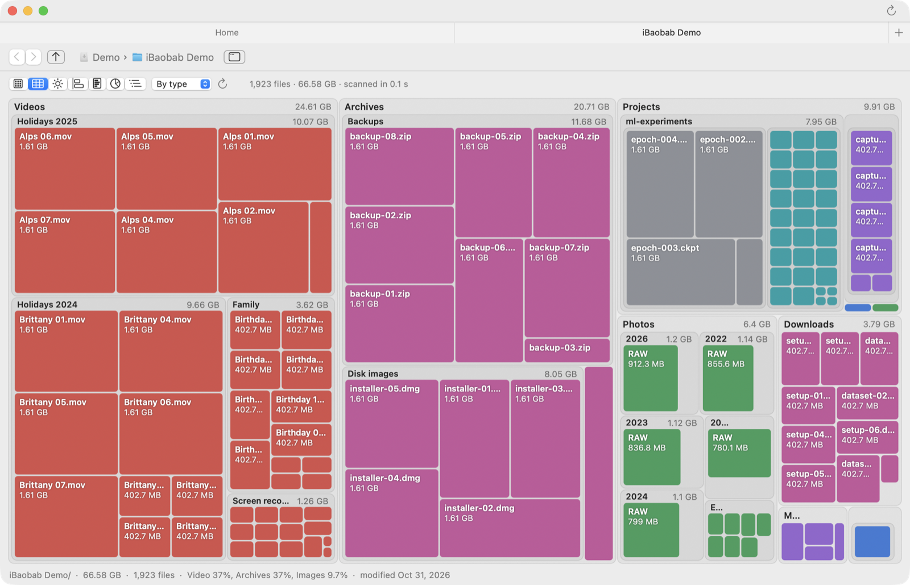
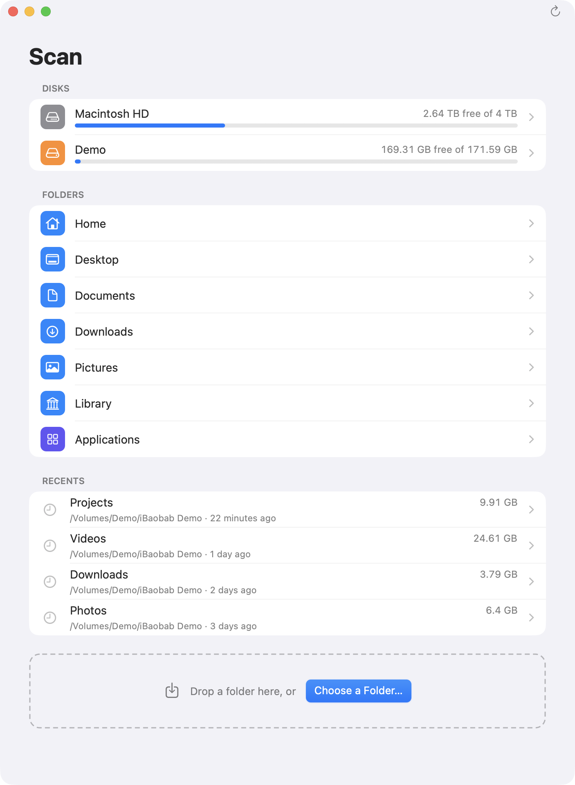
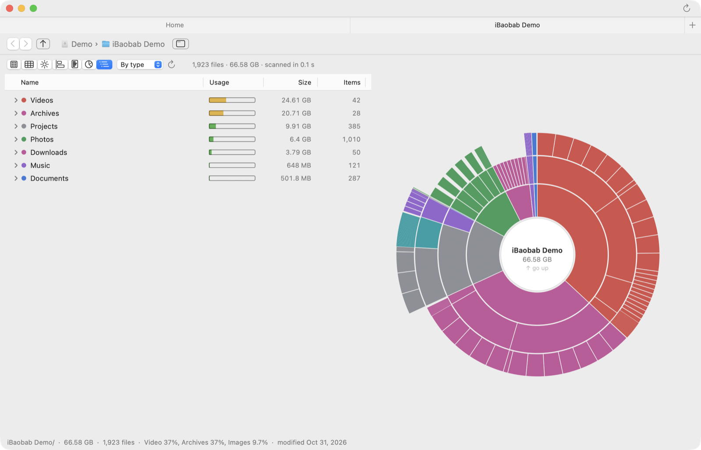
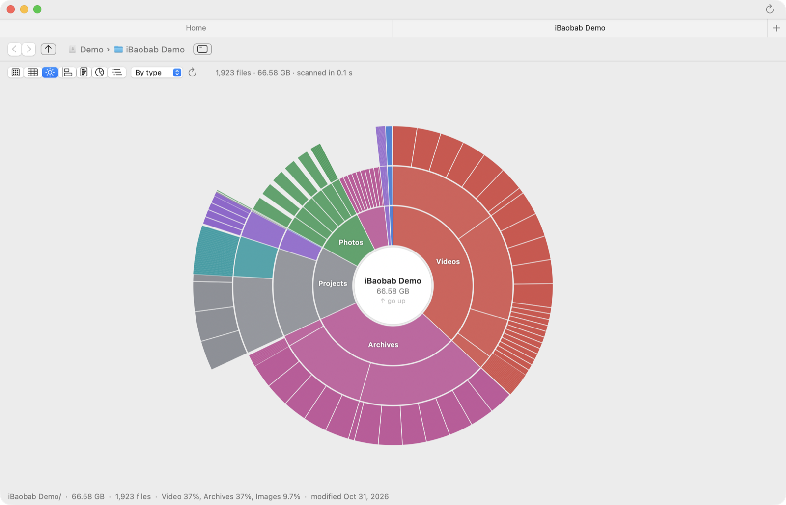
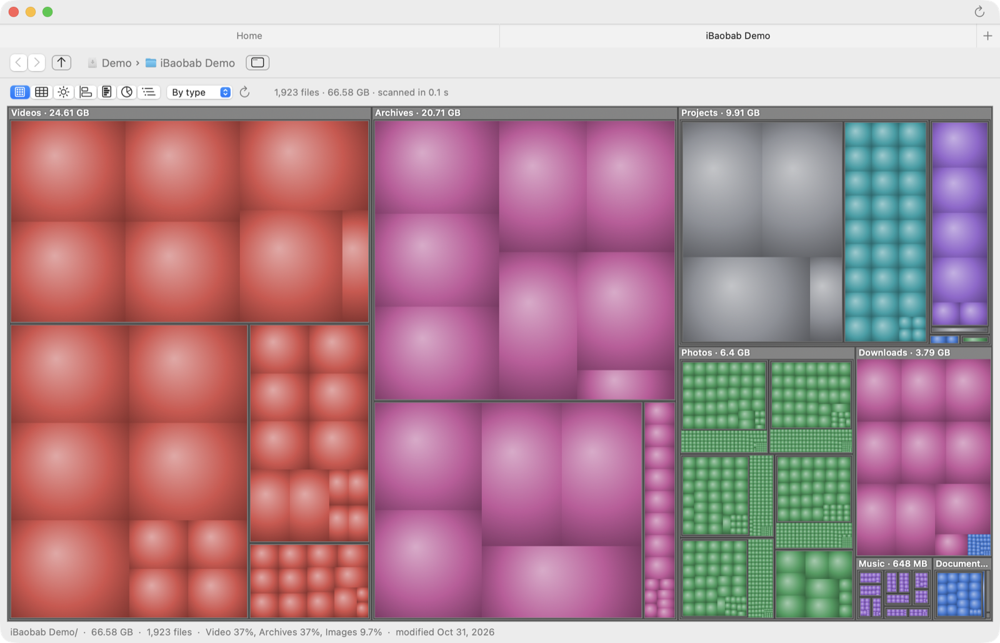
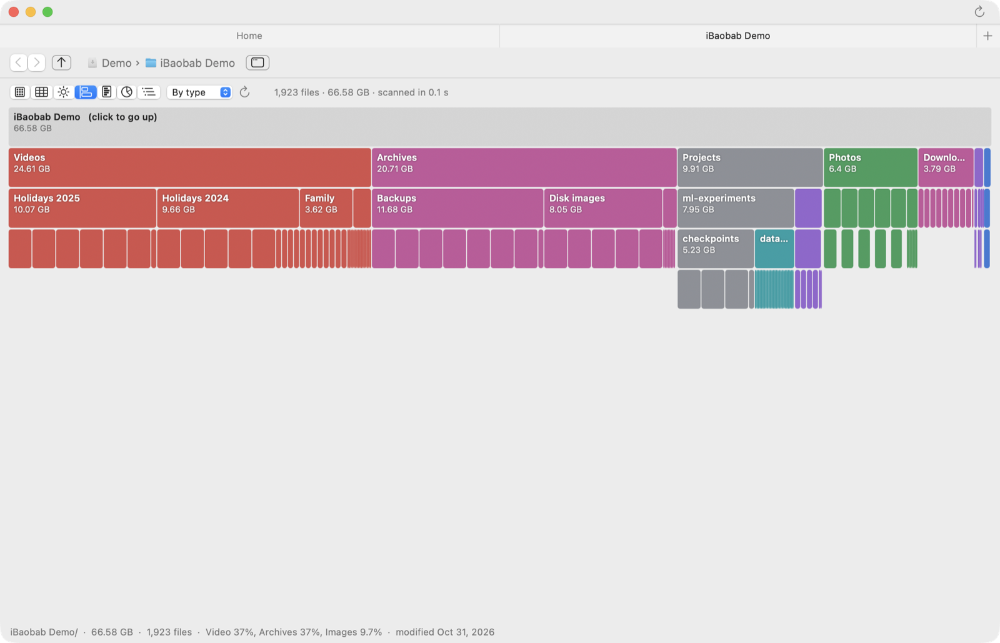
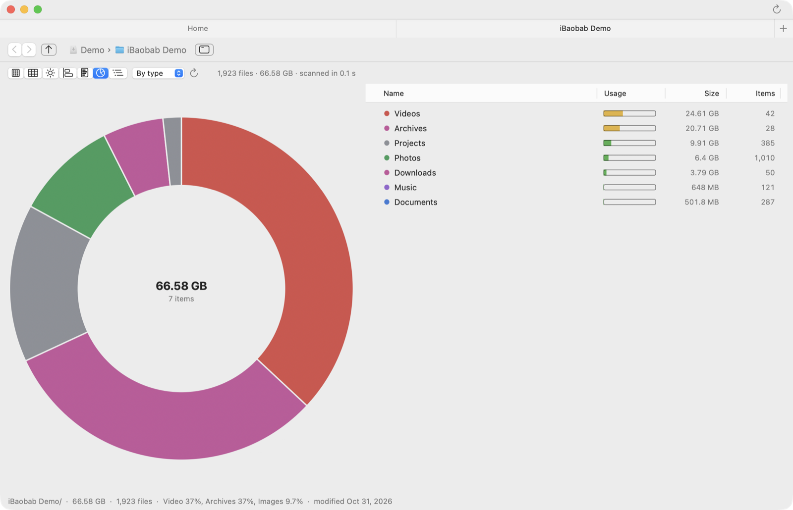
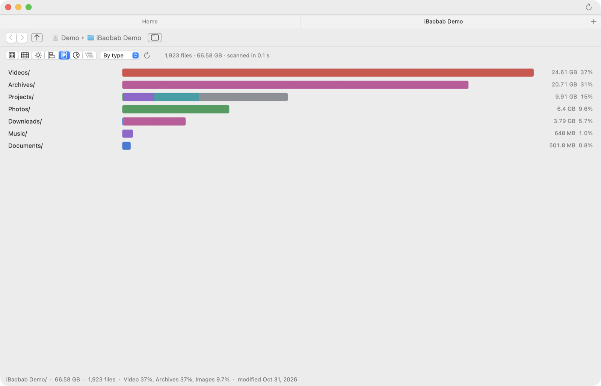
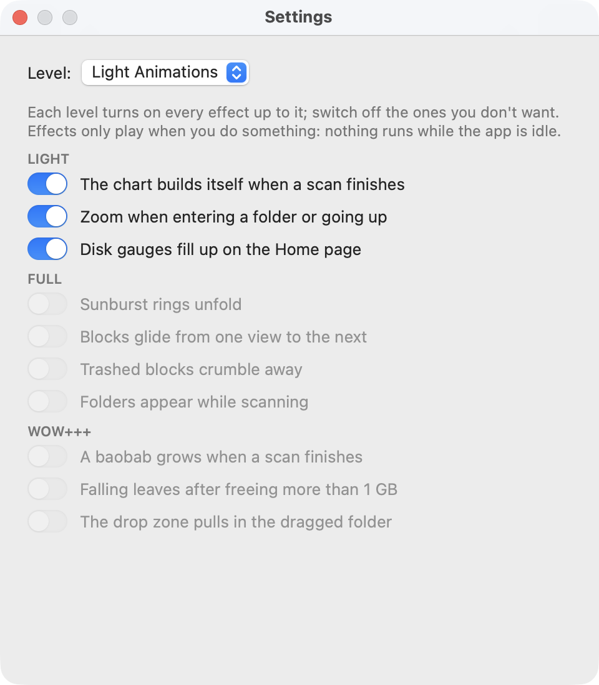

<p align="right"><b>English</b> · <a href="README.fr.md">Français</a></p>

# iBaobab

**See at a glance what fills your disk, and free up space.**

iBaobab is a disk usage analyzer for macOS, in the spirit of GNOME's Disk Usage Analyzer (Baobab). It scans a disk or a folder, then lets you browse the result through seven charts, colored by file type, age or branch. Native Swift and AppKit, no external dependency.

<p align="center">
  <picture>
    <source media="(prefers-color-scheme: dark)" srcset="docs/images/en/flat-dark.png">
    
  </picture>
</p>

> The screenshots show a fictional demo folder.

## Features

- **Home page** in grouped lists: your disks (usage bar, free space), common folders, recent scans (size and date) and a drop zone. You can also drop a folder on the Dock icon.
- **Fast and light scan**: whole directories are read in a few system calls, subfolders in parallel; a scan of `/Applications` (about 570,000 files) holds in about 50 MB of memory.
- **Seven views**, one click or ⌘1 … ⌘7 away: cushion treemap, flat treemap, sunburst, icicle, histogram, ring and list, list and sunburst.
- **Three colorings**: by file type (video, images, audio, code, archives, documents), by age, or by branch.
- **Navigation** by clicking into a folder, with the path bar, back and forward (⌘[ / ⌘]) and the parent folder (⌘↑ or ⌫). Hovering shows the size, the share of the parent, the number of files, the main types and the date.
- **Native tabs**: each scan opens in a tab; ⌘-click opens a subfolder in a new tab without scanning again.
- **Actions**: Show in Finder (⌥⌘R), Move to Trash, Scan Again (⌘R).
- **Animations you control**: four levels (none, light by default, full, Wow+++) and one switch per effect. Effects only play when you do something; nothing runs while the app is idle, and none play when *Reduce motion* is on.
- **English and French**, following the system language.
- **Automatic updates**, verified with an Ed25519 signature.

## Screenshots

### Home

Disks, common folders, recent scans, and a drop zone for any folder.

<p align="center">
  <picture>
    <source media="(prefers-color-scheme: dark)" srcset="docs/images/en/home-dark.png">
    
  </picture>
</p>

### Seven ways to look at a folder

<table>
  <tr>
    <td width="50%">
      <picture>
        <source media="(prefers-color-scheme: dark)" srcset="docs/images/en/list-sunburst-dark.png">
        
      </picture>
      <p align="center"><b>List and sunburst</b></p>
    </td>
    <td width="50%">
      <picture>
        <source media="(prefers-color-scheme: dark)" srcset="docs/images/en/sunburst-dark.png">
        
      </picture>
      <p align="center"><b>Sunburst</b></p>
    </td>
  </tr>
  <tr>
    <td>
      <picture>
        <source media="(prefers-color-scheme: dark)" srcset="docs/images/en/cushion-dark.png">
        
      </picture>
      <p align="center"><b>Cushion treemap</b></p>
    </td>
    <td>
      <picture>
        <source media="(prefers-color-scheme: dark)" srcset="docs/images/en/icicle-dark.png">
        
      </picture>
      <p align="center"><b>Icicle</b></p>
    </td>
  </tr>
  <tr>
    <td>
      <picture>
        <source media="(prefers-color-scheme: dark)" srcset="docs/images/en/donut-dark.png">
        
      </picture>
      <p align="center"><b>Ring and list</b></p>
    </td>
    <td>
      <picture>
        <source media="(prefers-color-scheme: dark)" srcset="docs/images/en/histogram-dark.png">
        
      </picture>
      <p align="center"><b>Histogram</b></p>
    </td>
  </tr>
</table>

### Animations

Choose a level, then switch off any effect you don't want: the chart building itself, zooming into folders, sunburst rings unfolding, blocks gliding from one view to the next, a baobab growing at the end of a scan…

<p align="center">
  <picture>
    <source media="(prefers-color-scheme: dark)" srcset="docs/images/en/settings-dark.png">
    
  </picture>
</p>

## Installation

With [Homebrew](https://brew.sh):

```bash
brew install --cask blegal/tap/ibaobab
```

Or by hand:

1. Download `iBaobab-<version>.dmg` from the [latest release](https://github.com/blegal/iBaobab/releases/latest).
2. Open it and drag **iBaobab** into **Applications**.
3. The app is not notarized by Apple. On first launch, open **System Settings › Privacy & Security** and click **Open Anyway**, or run:

   ```bash
   xattr -dr com.apple.quarantine /Applications/iBaobab.app
   ```

iBaobab then updates itself: the indicator on the right of the title bar turns green when a new version is available (yellow while it downloads), and **iBaobab › Check for Updates…** checks on demand. Each update is verified with an Ed25519 signature before it is installed.

Requires macOS 15 or later, on Apple Silicon or Intel.

## How it works

- **Scan**: `getattrlistbulk` reads a whole directory in a few system calls (name, type, allocated size, date); subfolders are scanned in parallel. Sizes are allocated sizes, as in the Finder's *Get Info*.
- **Memory**: each file or folder fits in a compact node (packed counters and dates, interned names).
- **Drawing**: charts are drawn with Core Graphics, only when needed. Animations work from images of the chart captured before and after a change, and the display link only runs while an effect plays.
- **Updates**: the app asks the GitHub API for the latest release, downloads the DMG, checks its signature with CryptoKit and the public key embedded in `Info.plist`, then swaps the app bundle and relaunches.

## Building from source

```bash
./build.sh          # produces build/iBaobab.app (ad hoc signed)
open build/iBaobab.app
```

Each build gets a new ad hoc signature, so macOS asks again for its permissions (Documents, Desktop, disks…).
Run `Tools/make-local-cert.sh` once: it creates a personal signing certificate, “Local Code Signing”, shared with my other apps, in your login keychain, and
`build.sh` then signs every build with it, so permissions are kept from one build to the next.

Requires Xcode (Swift 6). `UNIVERSAL=1 VERSION=1.0.0 ./build.sh` builds an Apple Silicon + Intel binary, and `Tools/make-dmg.sh` makes the disk image.

The `.github/workflows/release.yml` workflow builds the DMG on each push to `main` (run artifact, 30 days) and publishes a GitHub release, with its signature, for each `v*` tag:

```bash
git tag v1.0.0 && git push origin v1.0.0
```

- `Tools/bump-version.sh`: bumps the version before a commit (`minor` or `major` as an option).
- `Tools/l10n.py build`: regenerates `Resources/en.lproj/Localizable.strings` from `Tools/l10n/en.json` (the code is written in French).
- `swift Tools/make-update-key.swift`: makes the update key pair. The private key goes into the `UPDATE_SIGNING_KEY` repository secret, the public key into `Resources/Info.plist`. Optional secrets `MACOS_CERTIFICATE_P12` and `MACOS_CERTIFICATE_PASSWORD` sign with a stable certificate.

## Shared libraries

The package exports two libraries, also used by [iExplorer](https://github.com/blegal/iExplorer) and [GitWatch](https://github.com/blegal/GitWatch):

- **DiskUsageKit**: scanner, `DiskNode` model, the seven charts and the analysis page (`DiskUsageView`), with their animations (`DiskEffects.isEnabled`, provided by the host app; none by default).
- **UpdateKit**: automatic updates from GitHub releases (`Updater`, `UpdateStatusButton`).

```swift
.package(url: "https://github.com/blegal/iBaobab", branch: "main"),
// …
.product(name: "DiskUsageKit", package: "iBaobab"),
.product(name: "UpdateKit", package: "iBaobab"),
```

## Development

iBaobab was developed with the help of [Claude Code](https://claude.com/claude-code), Anthropic's coding assistant.
